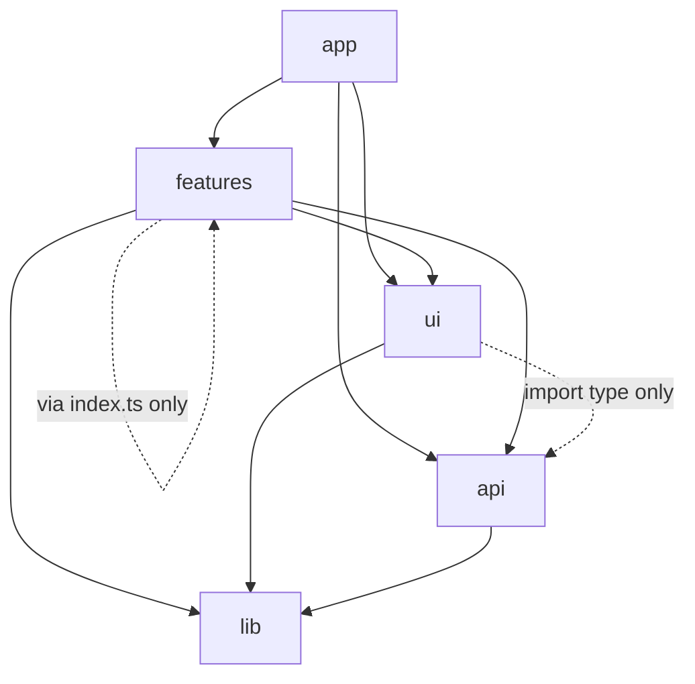
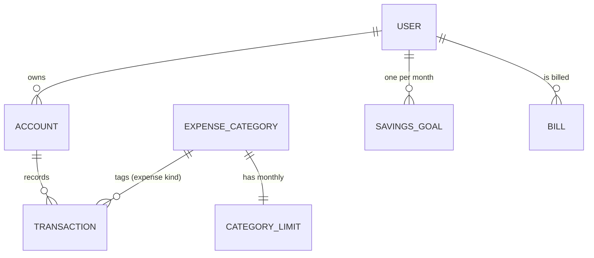
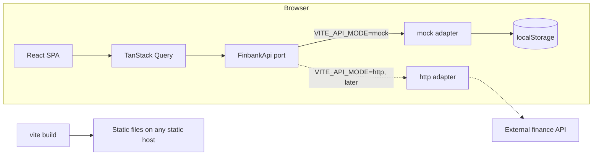

# Architecture Spine: Finbank Frontend

## Design Paradigm

The app is a **feature-sliced layered SPA**. Each PRD feature area is one folder under `src/features/`. Each feature composes domain-agnostic UI primitives from `src/ui/` and gets data only through the hooks in `src/api/`.

The data layer follows **ports and adapters**:
- `FinbankApi` is the single port.
- `mock` is the v1 adapter and `http` is the future one.
- Exactly one composition point in `src/app/` chooses the adapter.

| Layer | Directory | Owns |
| --- | --- | --- |
| App | `src/app/` | Bootstrapping, providers, adapter selection, route table, app shell |
| Features | `src/features/<area>/` | Screens, domain components and form schemas for one PRD area |
| UI | `src/ui/` | Design-system primitives and charts. No data fetching |
| API | `src/api/` | The port (`FinbankApi`), domain types, adapters, query keys and hooks |
| Lib | `src/lib/` | Pure helpers: money, dates, formatting, chart scale |
| Styles | `src/styles/` | Design tokens (`tokens.css`) and global CSS |

## Invariants & Rules

### AD-1: Dependency direction, enforced by lint

- **Binds:** all
- **Prevents:** circular imports, and UI primitives that fetch data or depend on features.
- **Rule:** Imports may only follow the arrows below.
  - `ui` may use `import type` from `api/types.ts` only.
  - A feature may import another feature only through that feature's `index.ts`.
  - Only `app` imports adapters.
  - The rules are enforced in `.oxlintrc.json` with `no-restricted-imports` patterns, `import/no-cycle` and `react-hooks/exhaustive-deps` set as errors.
  - `tsconfig` sets `"strict": true` explicitly.



### AD-2: All data goes through the `FinbankApi` port and query hooks

- **Binds:** all features, NFR-4, FR-33
- **Prevents:** screens importing mock data or `fetch` directly, which would block swapping the adapter.
- **Rule:**
  - Components read and write data only through hooks exported from `src/api/hooks/`.
  - The hooks call the `FinbankApi` instance from `ApiProvider` context.
  - Nothing outside `src/api/` imports from `src/api/mock/` or `src/api/http/`.
  - Domain types live only in `src/api/types.ts`.

### AD-3: One composition point chooses the adapter

- **Binds:** `src/app/`, deployment config
- **Prevents:** adapters being chosen per screen, or mock and http being mixed.
- **Rule:**
  - `src/app/providers.tsx` creates exactly one adapter, chosen by `import.meta.env.VITE_API_MODE` (`mock` by default, or `http`).
  - Every adapter implements the whole `FinbankApi` interface. An unimplemented http method throws `ApiError{code:'NOT_IMPLEMENTED'}`.

### AD-4: One owner per entity and per series

- **Binds:** FR-10 to FR-15, FR-21, FR-22, FR-33
- **Prevents:** Overview and the detail screens reading the same data from different methods and then disagreeing, or one of them going stale.
- **Rule:**
  - Each entity list and each derived series has exactly one port method and one hook (see the port seed).
  - Composite reads return aggregates only, never entity lists.
  - The Overview widgets reuse the detail screens' hooks:
    - `useAccounts()`
    - `useBills({ limit: 2 })`
    - `useTransactions({ kind, limit: 5 })`
    - `useComparison('week')`
    - `useCategorySummaries()`
    - `useSavingsGoal(currentMonth)`
    - `useBalanceSummary()`

### AD-5: Stored values vs derived values

- **Binds:** FR-10, FR-15, FR-22, FR-23, FR-25, FR-27
- **Prevents:** Total Balance, category totals or goal progress being calculated differently in different places, and user-entered values being overwritten.
- **Rule:**
  - **Stored (user-editable):**
    - `SavingsGoal.targetCents` and `achievedCents` (FR-25 "Present")
    - `CategoryLimit.limitCents`
    - account and profile fields
  - **Derived by the adapter:**
    - `totalBalanceCents`, which is assets minus liabilities
    - each category's `totalCents` and `changePct` (a signed integer percent)
    - comparison and saving-summary series
  - **Derived in `GoalGauge` only:** the gauge ratio, the 100% cap and the centre label.
  - Components never recalculate an adapter-derived value.
  - `Account.balanceCents` is always a non-negative magnitude. The adapter applies the sign from the account type when it calculates the total.

### AD-6: The mock adapter is the only owner of mock state

- **Binds:** FR-17, FR-31, FR-33
- **Prevents:** one hard-coded fixture per screen, and storage drift.
- **Rule:**
  - One seed dataset lives in `src/api/mock/seed.ts`. It is anchored to mock today, `2023-05-19`.
  - Every change is written through to `localStorage` under the key `finbank:mock:v1`.
  - A missing or unparseable entry falls back to the seed.
  - `removeAccount` also removes that account's transactions.
  - Before storage, the avatar is downscaled to a JPEG data URL of at most 256px.
  - If storage is full, the write fails with `ApiError{code:'STORAGE_FULL'}`.
  - The adapter adds an artificial delay of about 200 ms so that loading states are exercised. `[ASSUMPTION]`

### AD-7: Server state lives in TanStack Query, with one invalidation map

- **Binds:** all data-backed screens
- **Prevents:** stale cross-screen data (for example, the Overview goal or Total Balance after an edit) and ad-hoc cache keys.
- **Rule:**
  - Every read is `useQuery`. Paginated lists use `useInfiniteQuery`, and the cursor is never part of the key.
  - Every write is `useMutation`.
  - All of these hooks live in `src/api/hooks/`.
  - Query keys are hierarchical arrays from the `qk` factory in `src/api/queryKeys.ts`.
  - The same file exports `invalidationMap`, which maps each mutation to the key prefixes it invalidates. Mutation hooks invalidate only through this map. Seed:
    - `removeAccount` → `accounts`, `balanceSummary`, `transactions`
    - `updateSavingsGoal` → `savingsGoal`
    - `updateCategoryLimit` → `categoryLimits`
    - `updateProfile` → `profile`
    - `login` and `logout` → clear the whole cache
  - Query data is never copied into React state or context, except as default values for a form.

### AD-8: Client state stays local; Session holds identity only

- **Binds:** FR-6 to FR-9, FR-13, FR-19, FR-29, FR-30
- **Prevents:** a global store being added for state that doesn't need one, a stale user name after a profile edit, and deep links that don't work.
- **Rule:**
  - The only app-wide contexts are `ApiProvider` and `SessionProvider`.
  - `Session` is `{ userId, persistent }`. The name and avatar in the shell come from `useProfile()`.
  - Settings tab state lives in the URL (`?tab=account|security`).
  - Transaction tabs, dropdown selections and modal open state are component-local.
  - No global state library is used.

### AD-9: Money, dates, months and today

- **Binds:** FR-14, FR-23, FR-24, FR-28, FR-34
- **Prevents:** floating-point drift, dates shifting by a day across time zones, months being keyed differently, and screens disagreeing about "today".
- **Rule:**
  - **Amounts:** every amount is an integer `…Cents` field. That includes chart tick constants.
  - **Calendar dates:** `IsoDate` (`YYYY-MM-DD`).
  - **Months:** the branded type `YearMonth` (`YYYY-MM`). Every month-scoped port method and query key uses it.
  - **Parsing and arithmetic:** only `src/lib/dates.ts` parses or does arithmetic on dates. It uses date-fns with `weekStartsOn: 0`, and owns `currentMonth`, `monthRange`, `weekOf` and `selectableMonths`.
  - **Today:** read through `useToday()`, which is backed by `FinbankApi.getToday()`. `RequireSession` waits for today to load before it renders, so `useToday()` always returns an `IsoDate`.
  - Features never call `new Date()` or `Date.parse`.
  - Series points after today are `null`.

### AD-10: All display formatting goes through `src/lib/format.ts`

- **Binds:** FR-34
- **Prevents:** inconsistent currency, decimal, percent and date formats between screens.
- **Rule:**
  - Components format values only with these functions:
    - `formatMoney(cents, 'whole' | 'exact')`. The FR-34 contexts that show no decimals use `'whole'`; everything else uses `'exact'`.
    - `formatCompact(cents, 'gauge' | 'axis')`, which gives "12K" or "$2k"
    - `formatPercent(changePct)`, which gives "08%"
    - `formatDate(iso, 'row' | 'badge' | 'header' | 'axisDay' | 'weekday' | 'month')`
    - `formatRange(yearMonth)`, which gives "01 May ~ 31 May"
    - `maskAccountNumber(num, 'groups' | 'tail4')`
  - No component calls `Intl` or `toFixed` directly.

### AD-11: Design tokens have a single source

- **Binds:** NFR-1, every styled element
- **Prevents:** hex values and spacing drifting away from Figma, and chart colours coming out empty.
- **Rule:**
  - Colours, fonts, the type scale, radii, shadows and the focus ring are defined once, in `src/styles/tokens.css`, using Tailwind v4 `@theme`. The token values come from the PRD addendum.
  - Tokens that are read only from JavaScript (chart colours) are declared under `@theme static`.
  - Components use token-backed utilities only. Hex literals and arbitrary colour or font-size values are not allowed outside `tokens.css`.
  - `chartColors` in `src/ui/charts/` reads the CSS variables. A unit test asserts that every entry is non-empty.

### AD-12: UI primitives and domain components each have one owner

- **Binds:** NFR-1, NFR-3, all features
- **Prevents:** two features building the same component twice, or restyling primitives locally.
- **Rule:**
  - `src/ui/` owns the primitives. A new look is added as a variant here, never as a local restyle.
    - `Button`, with the variants `primary`, `outline`, `text` and `google`
    - inputs: `TextInput`, `PasswordInput`, `MoneyInput` (emits cents or `null`), `PhoneInput` and `Checkbox`. Every input requires a `label` prop.
    - layout and display: `Card`, `Tabs`, `Dropdown`, `Table`, `LoadMore`, `Carousel`, `DateBadge`, `TrendIndicator`, `CategoryIcon` (owns the category label and icon map), `Skeleton`, `EmptyState`, `AsyncSection`, `Modal` and `ConfirmDialog`
    - charts: `ComparisonBarChart`, `ComparisonAreaChart` and `GoalGauge`. Every chart requires a `summary` text prop (NFR-3).
  - Domain components are owned by one feature and exported from its `index.ts`:

| Component | Owner |
| --- | --- |
| `AccountCard` | `balances` |
| `TransactionList` | `transactions` |
| `BillList` | `bills` |
| `ComparisonChartCard` | `expenses` |
| `CategorySummaryCard` / `Tile` | `expenses` |
| `SavingsGoalCard` | `goals` |
| `AdjustSavingsGoalModal` | `goals` |

### AD-13: Modals render into the content area

- **Binds:** FR-11, FR-17, FR-25, FR-27, NFR-3
- **Prevents:** a full-screen overlay that dims the sidebar and top bar, and shell controls that stay clickable behind a modal.
- **Rule:**
  - `Modal` and `ConfirmDialog` portal into `#content-overlay-root`, which `AppShell` renders inside the content column. The overlay dims only that column.
  - While a modal is open, `AppShell` sets `inert` on the sidebar and top bar.
  - `Modal` traps focus, closes on Esc and on overlay click, and returns focus to the element that opened it.
  - A removal from Account Details keeps the user on the page while the mutation runs, with the confirm dialog open and pending. Only after it succeeds does the app replace the route with `/balances`, so Back never returns to the removed account. A failure keeps the user on Account Details with the error shown in the dialog, and Confirm can be retried. While the removal settles, the page keeps rendering the account being removed, so it never shows "Account not found" behind the dialog. *(Revised 2026-11-17 by human decision during Story 2.4. It replaces "navigate to `/balances` first, then fire the mutation", which hid failures.)*

### AD-14: Routing follows one route table

- **Binds:** FR-1 to FR-9, FR-29
- **Prevents:** path drift and duplicate auth guards.
- **Rule:**
  - `src/app/router.tsx` holds the single `createBrowserRouter` table.
  - Public routes are `/login`, `/signup` and `/forgot-password`.
  - All other routes sit under one `RequireSession` layout route, which renders `AppShell`.
  - The `AppShell` routes are:
    - `/` (Overview)
    - `/balances`
    - `/balances/:accountId`
    - `/transactions`
    - `/bills`
    - `/expenses`
    - `/goals`
    - `/settings`
  - The active nav item matches on the first path segment.
  - Paths are referenced only through the `routes` constants object.

### AD-15: Forms use react-hook-form and zod

- **Binds:** FR-1 to FR-5, FR-25, FR-27, FR-28, FR-30 to FR-32
- **Prevents:** a mix of validation styles, error displays and success messages.
- **Rule:**
  - Each form has a zod schema in its feature's `schemas.ts` and uses `zodResolver`.
  - Field errors appear through the input primitive's `error` prop.
  - `ApiError.fieldErrors` are mapped to `setError`.
  - Success uses the shared `FormStatus` inline message (FR-35).

### AD-16: Chart scale is a pure function

- **Binds:** FR-14, FR-21, FR-24
- **Prevents:** two charts each implementing the design's uneven y axis differently, or mixing dollars and cents.
- **Rule:**
  - `src/lib/chartScale.ts` exports `createTickScale(ticksCents)`, which returns `{ toPlot(v), ticks }`. Its ticks are evenly spaced and values between them are interpolated linearly.
  - It also exports the tick constants:
    - `BAR_TICKS = [0, 2_000_00, 10_000_00, 50_000_00, 250_000_00]`
    - `SAVING_TICKS = [0, 500_00, 2_000_00, 5_000_00]`
  - Charts plot the `toPlot` values, using recharts `ticks` and `tickFormatter` for the labels.

### AD-17: Every query-backed card has the same loading, empty and error states

- **Binds:** FR-35
- **Prevents:** each card inventing its own spinner and error text.
- **Rule:** Every query-backed card renders through `AsyncSection`, which takes `query`, `isEmpty` and `children`:
  - `Skeleton` while loading
  - `EmptyState` when the data is empty
  - an inline danger-colour message with a retry option on error

## Consistency Conventions

| Concern | Convention |
| --- | --- |
| File naming | Components: `PascalCase.tsx`, one component per file. Hooks: `useThing.ts`. Other modules: `camelCase.ts`. Tests sit next to the file as `*.test.ts(x)`. |
| Feature folder | `features/<area>/` contains `index.ts` (public exports), `<Area>Page.tsx`, `components/` and, optionally, `schemas.ts`. |
| Domain types | `Account`, `Transaction`, `Bill`, `ExpenseCategoryId` (union of 6), `CategorySummary`, `SavingsGoal`, `CategoryLimit`, `UserProfile`, `Session`, `IsoDate`, `YearMonth`. IDs are opaque strings such as `acc_1` or `txn_42`. |
| Port methods | `getX` / `listX` for reads, `updateX` / `removeX` for writes. Paginated lists take `{ cursor?, limit }` and return `{ items, nextCursor }`. The page size is 10. |
| Ordering | Adapters return lists already sorted. Transactions: date descending. Bills: due date ascending. Accounts: seed order. |
| Errors | Adapters throw only `ApiError { code, message, fieldErrors? }`. UI copy comes from `message`. |
| Auth | The mock adapter stores the session under the key `finbank:session`, separate from the mock data: in `localStorage` when "Keep me signed in" is checked, in `sessionStorage` when not. Google sign-in calls `loginWithGoogle()`, which is a mock login. |
| Config | The only env var is `VITE_API_MODE`, plus `VITE_API_BASE_URL` when the mode is `http`. |
| Icons | UI and category icons come from `lucide-react` through the single map in `src/ui/icons.ts`. `[ASSUMPTION: replace with closer-matching SVGs if NFR-1 review fails]` Brand logos (Google, Mastercard, VISA, Figma, Adobe) are official brand-asset SVGs, stored in `src/assets/brands/`. The wordmark is rebuilt and matched to the PNGs, because the repo has no Figma source. |
| Copy | UI strings are inline English. No i18n layer. |
| Testing | Vitest with jsdom. Unit tests cover `lib/` and the mock adapter: derivations, persistence and `chartColors`. React Testing Library covers forms and modals. No e2e tests in v1. |

## Stack

These versions were verified on npm on 2026-11-16, and a scratch build of the starter compiled. The code owns them from here on.

| Name | Version |
| --- | --- |
| Node.js | >=22.22 (`.nvmrc`: 24 LTS) |
| create-vite (react-ts template) | 9.3.4 |
| React / react-dom | 19.3.1 |
| TypeScript | ~7.0.2 |
| Vite | 8.3.8 |
| @vitejs/plugin-react | 6.3.0 |
| Tailwind CSS / @tailwindcss/vite | 4.3.5 |
| react-router | 8.5.1 |
| @tanstack/react-query | 5.107.1 |
| recharts | 3.10.1 |
| react-hook-form | 7.92.0 |
| zod | 4.6.7 |
| @hookform/resolvers | 7.0.6 |
| date-fns | 4.4.0 |
| lucide-react | 1.73.0 |
| oxlint (from the starter) | ^1.90.0 |
| vitest | 5.1.0 |
| jsdom | 31.0.1 |
| @testing-library/react | 16.3.3 |
| @testing-library/dom | 10.4.2 |
| @testing-library/jest-dom | 7.0.1 |

## Structural Seed

```text
src/
  app/          # main.tsx, providers.tsx, router.tsx, routes.ts, RequireSession, AppShell/
  features/
    auth/          # FR-1..5
    overview/      # FR-10..15 (composes other features' exports)
    balances/      # FR-16..18, AccountCard
    transactions/  # FR-19, TransactionList
    bills/         # FR-20, BillList
    expenses/      # FR-21..22, ComparisonChartCard, CategorySummaryCard
    goals/         # FR-23..28, SavingsGoalCard, AdjustSavingsGoalModal, AdjustCategoryLimitModal
    settings/      # FR-29..32
  ui/           # primitives, charts/, icons.ts
  api/
    types.ts  port.ts  queryKeys.ts (qk + invalidationMap)
    hooks/      # one hook per port method
    mock/       # seed.ts, mockApi.ts
    http/       # httpApi.ts (stub)
  lib/          # money.ts, dates.ts, format.ts, chartScale.ts
  styles/       # tokens.css, index.css
  assets/brands/
vitest.config.ts  .oxlintrc.json  .nvmrc
```

The port is outlined below. It is a seed: the code owns the exact signatures.

```ts
interface FinbankApi {
  getToday(): Promise<IsoDate>;
  // session
  login(i: LoginInput): Promise<Session>; loginWithGoogle(): Promise<Session>; signup(i: SignupInput): Promise<Session>;
  requestPasswordReset(email: string): Promise<void>; logout(): Promise<void>; getSession(): Promise<Session | null>;
  // accounts, transactions, bills
  getBalanceSummary(): Promise<{ totalBalanceCents: number }>;
  listAccounts(): Promise<Account[]>; getAccount(id: string): Promise<AccountDetail>; removeAccount(id: string): Promise<void>;
  listTransactions(q: { kind?: 'revenue' | 'expense'; accountId?: string; cursor?: string; limit: number }): Promise<Page<Transaction>>;
  listBills(q?: { limit?: number }): Promise<Bill[]>;
  // expenses & goals
  getComparison(granularity: 'week' | 'year'): Promise<ComparisonPoint[]>;   // current vs previous; null after today
  listCategorySummaries(): Promise<CategorySummary[]>;                       // month containing today; latest 2 items each
  getSavingsGoal(month: YearMonth): Promise<SavingsGoal>;
  updateSavingsGoal(month: YearMonth, i: { targetCents: number; achievedCents: number }): Promise<SavingsGoal>;
  getSavingSummary(month: YearMonth): Promise<ComparisonPoint[]>;
  listCategoryLimits(): Promise<CategoryLimit[]>; updateCategoryLimit(id: ExpenseCategoryId, limitCents: number): Promise<CategoryLimit>;
  // settings
  getProfile(): Promise<UserProfile>; updateProfile(i: ProfileInput): Promise<UserProfile>; changePassword(i: PasswordInput): Promise<void>;
}
```





## Capability → Architecture Map

| PRD area | Lives in | Governed by |
| --- | --- | --- |
| Auth (FR-1 to FR-5) | `features/auth`, `SessionProvider` | AD-8, AD-14, AD-15, Auth convention |
| App shell (FR-6 to FR-9) | `app/AppShell` | AD-8, AD-13, AD-14 |
| Overview (FR-10 to FR-15) | `features/overview` | AD-4, AD-5, AD-7, AD-12 |
| Balances and Account Details (FR-16 to FR-18) | `features/balances` | AD-4, AD-6, AD-7, AD-13 |
| Transactions and Bills (FR-19, FR-20) | `features/transactions`, `features/bills` | AD-4, AD-7, AD-10, Ordering |
| Expenses (FR-21, FR-22) | `features/expenses` | AD-4, AD-5, AD-16 |
| Goals (FR-23 to FR-28) | `features/goals` | AD-5, AD-7, AD-9, AD-13, AD-15 |
| Settings (FR-29 to FR-32) | `features/settings` | AD-6, AD-8, AD-15 |
| Consistency, formatting and states (FR-33 to FR-35) | `api/mock`, `lib/`, `ui/AsyncSection` | AD-5, AD-6, AD-9, AD-10, AD-17 |
| Fidelity and accessibility (NFR-1, NFR-3) | `styles/tokens.css`, `ui/` | AD-11, AD-12, AD-13 |
| Swappable data (NFR-4) | `api/` | AD-2, AD-3 |

## Deferred

- **Hosting, CI and environments:** the app is a static build that runs on any static host. The host must rewrite unknown paths to `index.html` so client-side routes load. The host and pipeline are chosen when a deployment target exists. Until then the only environment is local `vite dev` / `vite preview` in mock mode.
- **http adapter mapping:** endpoints, auth tokens and retries are decided when an external provider is chosen. Only the port is fixed now.
- **Visual-regression tooling** for the NFR-1 overlay check (for example, Playwright screenshots): decided at the first fidelity review.
- **Browser support:** current evergreen desktop browsers. A formal support matrix is not needed for a mock v1.
- **Error monitoring, analytics and i18n:** not needed for a mock-data v1.
- **Responsive layouts:** out of scope according to PRD NFR-2.
